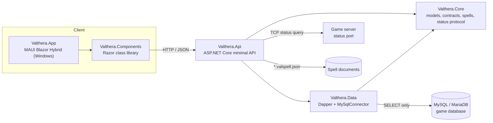

# Valthera App

A companion app for players of **Valthera**, a Tibia open-tibia (OT) server built on the Hellgrave Exodus base.
It shows the live server status, highscores, online players, recent deaths, character profiles and the documented
spells, all read from the server database through a small REST API.

The repository is a .NET 10 portfolio project: a minimal API with Dapper, a Blazor component library, a
.NET MAUI Blazor Hybrid app for Windows, tests, Docker and CI.

## Screenshots

_Screenshots will be added here._

## Architecture



| Project | Purpose |
| --- | --- |
| `src/Valthera.Core` | Models, contracts, vocation and highscore catalogs, OT status protocol client and parser, spell catalog, built-in sample data. |
| `src/Valthera.Data` | MySQL implementation of the data source with Dapper. Read-only, always parameterized. |
| `src/Valthera.Api` | ASP.NET Core minimal API: output cache, rate limiting, CORS for GET, ProblemDetails, OpenAPI in development. |
| `src/Valthera.Components` | Razor class library: pages, layout, small components and the typed API client. Reusable by other Blazor hosts. |
| `src/Valthera.App` | MAUI Blazor Hybrid host (Windows). Stores the API URL in preferences and opens the CSV export in the system browser. |
| `tests/Valthera.Tests` | xUnit tests for core logic, the API and the API client. |

## API endpoints

| Method | Route | Description |
| --- | --- | --- |
| GET | `/api/status` | Live server status (online, players, peak, uptime, version). |
| GET | `/api/highscores?category=level&vocation=&page=1&pageSize=25` | One page of a ranking. Categories: `level`, `magiclevel`, `fist`, `club`, `sword`, `axe`, `distance`, `shielding`, `fishing`. Invalid category returns 400. |
| GET | `/api/highscores/export.csv?category=&vocation=` | CSV export of the top 1000 entries. |
| GET | `/api/online` | Characters currently online. |
| GET | `/api/deaths?limit=20` | Most recent deaths (maximum 100). |
| GET | `/api/players/{name}` | Character profile with recent deaths. 404 when it does not exist. |
| GET | `/api/spells/classes` | Spell classes with spell counts. |
| GET | `/api/spells?class=` | Spell summaries, optionally for one class. |
| GET | `/api/spells/{class}/{name}` | Full spell description. |
| GET | `/api/vocations` | Vocation ids and names. |
| GET | `/health` | Health check. |

## Getting started

Requirements: .NET SDK 10. The MAUI app also needs the `maui-windows` workload and the WebView2 runtime.

### Run the API in Sample mode

Sample mode uses built-in fictional data, so no database is needed.

```powershell
dotnet run --project src/Valthera.Api
```

The API listens on `http://localhost:5080`. Try `http://localhost:5080/api/status`.

### Run the API against MySQL

Set the data source and keep the connection string out of the repository, using
[user-secrets](https://learn.microsoft.com/aspnet/core/security/app-secrets):

```powershell
dotnet user-secrets set "ConnectionStrings:Valthera" "<your connection string>" --project src/Valthera.Api
dotnet run --project src/Valthera.Api -- --Valthera:DataSource=MySql
```

Other settings live in the `Valthera` configuration section (`ServerName`, `Status:Host`, `Status:Port`,
`Status:TimeoutMs`, `Spells:Folder`, `RateLimit:PermitPerMinute`) and can be overridden with environment
variables such as `Valthera__Status__Host`. Use a **read-only MySQL user** (see Security).

### Run with Docker

```powershell
docker compose up --build
```

The API runs in Sample mode on `http://localhost:8080`. To use a real database, pass
`Valthera__DataSource=MySql` and `ConnectionStrings__Valthera` through an environment file that is not committed.

### Run the app (Windows)

```powershell
dotnet workload install maui-windows
dotnet run --project src/Valthera.App -f net10.0-windows10.0.19041.0
```

The app connects to `http://localhost:5080` by default. Change the address in the **Configurações** page; it
takes effect immediately, without restarting.

## Security notes

- Create a dedicated **read-only MySQL user** (`SELECT` on the needed tables only) for the API. The API itself
  only issues `SELECT` statements.
- No credentials, connection strings or server addresses are stored in the repository. The connection string is
  read from user-secrets or environment variables, and the API fails at startup with a clear message when it is
  missing in MySql mode.
- Highscore categories map to SQL columns through a fixed whitelist; user text is never concatenated into SQL,
  and every value is passed as a query parameter.
- Game masters and tutors (`group_id >= 3`) and deleted characters are hidden from public lists.
- Rate limiting per client IP on `/api`, CORS restricted to GET, ProblemDetails responses without stack traces
  in production, output cache to protect the database.
- The Docker image runs as a non-root user.

## Tests

```powershell
dotnet test tests/Valthera.Tests -c Release
```

The suite covers the vocation and highscore catalogs, the OT status protocol (request bytes and XML parser),
the spell catalog, the sample data source, CSV escaping, the API (through `WebApplicationFactory`) and the
typed API client (with a stub `HttpMessageHandler`).

## Continuous integration

GitHub Actions (`.github/workflows/ci.yml`) runs two jobs:

- `backend` on Ubuntu: restores, builds and tests the API, libraries and test project. The MAUI project is not
  built there.
- `app` on Windows: installs the `maui-windows` workload and builds `src/Valthera.App` in Release.

## Roadmap

- Android target for the app (add `net10.0-android` to the app project and install the Android workload).
- Push notifications for server events.
- A Blazor website reusing `Valthera.Components`.
- Portuguese and English localization.

## License

MIT. See [LICENSE](LICENSE).
